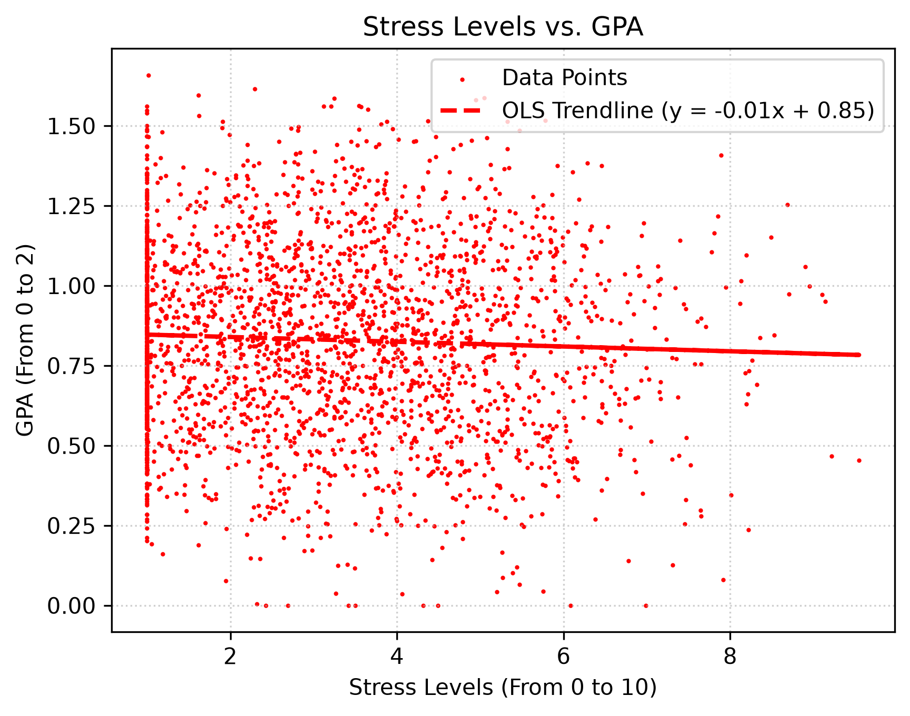

# GPA Correlation with Various College Student Habits
Analyzes the effect of various habits and factors on a college students' GPA score.


## Description
This project performs a statistical analysis on a CSV file from Kaggle that contains various college student habits as well as GPA information. Each row represents a students scores for each category (habit). 

This program begins by calculating z-scores for students in the following domains: mental health, digital discipline, financial security, physical health, and academic performance. It then uses those z-scores to calculate the correlation (from 0 to 1) that each domain has with the students GPA, and these correlations are plotted in a chart. (Note: for the purposes of this project, GPA is a score out of 2)

This program also produces a scatter plot that compares mental health scores (from 0 to 10) with GPA scores (from 0 to 2). Because producing a scatter plot with 1,000,000 points would be visually problematic, a random sample of 2,500 students is used.

### Dataset
https://www.kaggle.com/datasets/sharmajicoder/college-students-habits-and-performance/data


### Domain Descriptions
- Mental Health: stress, anxiety, depression, motivation, concentration, self discipline
- Digital Discipline: social media hours, gaming hours, netflix hours, screen time, phone unlocks per day
- Financial Security: family income, parental education level, part-time hours, financial stress
- Physical Health: sleep hours, physical activity, junk food frequency, caffeine, late night frequency
- Academic Performance: attendance, assignment completion, midterm score, final score, project score, online courses completed, peer study group, class participation, weekly study sessions, group study hours, study hours

### Pipeline Structure
- src/data_loader.py: Receives the CSV, performs preprocessing
- src/features.py: Separates the various domains, determines z-scores, and then uses the z-scores to calculate correlations
- src/plots.py: Visualizes the data

### Results




### Interpretation of results
We can see that among the various domains, academic performance was the domain with the highest correlation with GPA (0.820). This makes sense because the academic performance domain contains the following categories: attendance, assignment completion, midterm score, final score, project score, online courses completed, peer study group, class participation, weekly study sessions, group study hours, study hours. The domain that has the least correlation with GPA is the domain digital discipline, or how well the student controls their recreational screen time (0.335). While this is the lowest correlation out of those that we measured, it is still indeed a correlation, and it should be recognized that a college student's control over their screen time does indeed affect to a certain extent their GPA. 

From the scatter plot, we can see that there is a negative relationship between stress and GPA. Thus the more stressed out that you are, the lower your GPA is projected to be. However, the line of best fit on this chart has a slope of -0.01, which is very slight. 

### Potential Limitations and Biases
While this data set was extremely large (1,000,000 rows), it is a fully synthetic data set. However, it is statically structured so that it can resemble realistic academic environments. 

## Getting Started

### Dependencies
The project requires Python and these packages:
`pandas`
`numpy`
`matplotlib`
`pathlib`


### Executing the Program
Run the following commands, in the order listed:
```
python src/features.py
python src/plots.py
```