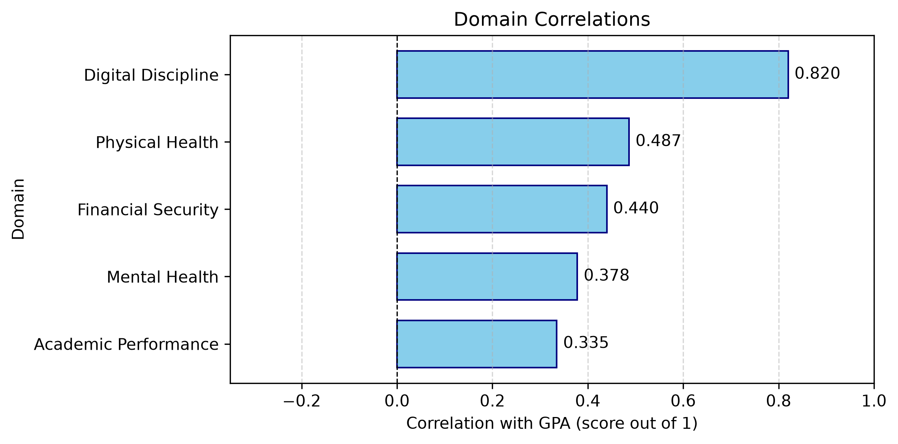

# GPA Correlation with Various College Student Habits
Analyzes the effect of various habits on a college students' GPA score.


## Description
This project performs a statistical analysis on a CSV file from Kaggle that contains various college student habits as well as GPA information. Each row represents a students scores for each category (habit). This program begins by calculating z-scores for students in the following domains: mental health, digital discipline, financial security, physical health, and academic performance. It then uses those z-scores to calculate the correlation (from 0 to 1) that each domain has with the students GPA, and these correlations are plotted in a chart. (Note: for the purposes of this project, GPA is a score out of 10)

### Pipeline Structure
src/data_loader.py: Receives the CSV, performs preprocessing
src/features.py: Separates the various domains, determines z-scores, and then uses the z-scores to calculate correlations
src/plots.py: Visualizes the data

### Results
#### Correlation by Domain (out of 1)
Digital Discipline        0.334960
Physical Health           0.377966
Financial Security        0.439708
Mental Health             0.486617
Academic Performance      0.819934




## Getting Started

### Dependencies
The project requires Python and these packages:
`pandas`
`numpy`
`matplotlib`
`pathlib`


### Executing the Program
Run the following commands, in the order listed:
```
python src/features.py
python src/plots.py
```